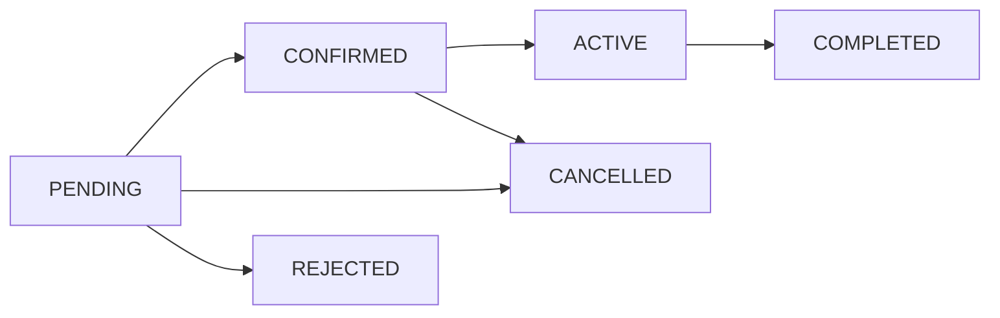

# Car Rental REST API

A TypeScript and Express backend for a small rental fleet. Customers can search vehicles, preview prices, book, pay, cancel, and review completed rentals. Administrators manage the fleet, customers, bookings, coupons, and maintenance, and can inspect dashboard and revenue reports.

## Stack and layout

Node.js 20+, Express 5, PostgreSQL 16, Prisma 6, Zod 4, JWT, bcrypt, Pino, Jest, and Swagger UI. Source code follows `routes -> controller -> service -> Prisma`; business rules live in services. The database has 12 tables, diagrammed in [docs/ER_DIAGRAM.md](docs/ER_DIAGRAM.md). The original requirements are in [the backend specification](../docs/CAR_RENTAL_BACKEND_SPEC.md).

```text
prisma/                 schema, migration, idempotent demo seed
src/common/             errors, auth, validation, response helpers
src/config/             environment, constants, Prisma, Swagger
src/modules/            feature routes, controllers, schemas, services
tests/unit/             pricing and booking rule tests
docs/                   ER diagram and endpoint overview
```

## Quick start with Docker

Create `Backend/.env` from `.env.example` and set the database password and JWT secrets. Then run from `Backend`:

```powershell
docker compose up --build
```

Compose starts PostgreSQL and the API. The API container applies the committed migration and runs the idempotent seed before listening on `http://localhost:8000`. Swagger UI is at `http://localhost:8000/api/docs`; the machine-readable document is at `/api/docs.json`. Local PostgreSQL is exposed on port 5433.

## Local development

Start PostgreSQL using `docker compose up -d postgres`, then:

```powershell
Copy-Item .env.example .env
npm ci
npm run db:migrate
npm run db:seed
npm run dev
```

Use `npm run lint`, `npm run build`, and `npm test` to validate the backend. Keep `.env` private. `DATABASE_URL`, `POSTGRES_USER`, `POSTGRES_PASSWORD`, and `POSTGRES_DB` configure the database; `JWT_ACCESS_SECRET` and `JWT_REFRESH_SECRET` must each contain at least 32 characters; `CORS_ORIGIN` and `PORT` configure HTTP.

## Demo accounts

| Role | Email | Password |
| --- | --- | --- |
| Administrator | `admin@carrental.com` | `Admin@12345` |
| Customer | `customer1@example.com` | `Customer@12345` |
| Customer | `customer2@example.com` | `Customer@12345` |
| Customer | `customer3@example.com` | `Customer@12345` |

The seed includes three locations, five categories, twenty vehicles, two coupons, and ten example bookings across the lifecycle. Change the demo passwords before exposing a deployed instance.

## Booking design



Reservation creation locks the vehicle row and checks overlapping bookings inside a serializable transaction. Bookings store the quoted daily rate, days, discounts, tax, and deposit. Payment processing uses a mock gateway behind a small interface. Cancellation and returns create refund or late-fee payment records in transactions. Customers may access only their own booking and payment records.

For request examples, authorization, and full endpoint details, use Swagger. [docs/API.md](docs/API.md) gives a short overview. Success responses use `{ "success": true, "data": ..., "meta": ... }`; errors use `{ "success": false, "error": { "code": "...", "message": "...", "details": [] } }`.

## Limitations and future improvements

Payments are simulated; there is no card processor, email or SMS delivery, image upload service, multi-currency support, or distributed cache. These can be added behind the existing interfaces. The API is independent of the separate frontend in this repository. Database-backed integration tests require a running PostgreSQL instance; the unit suite runs without one.
