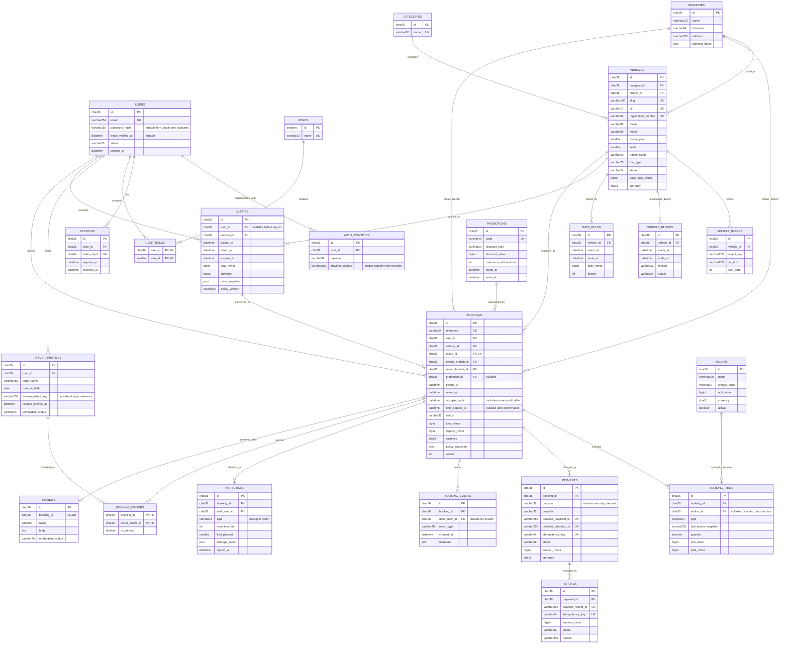
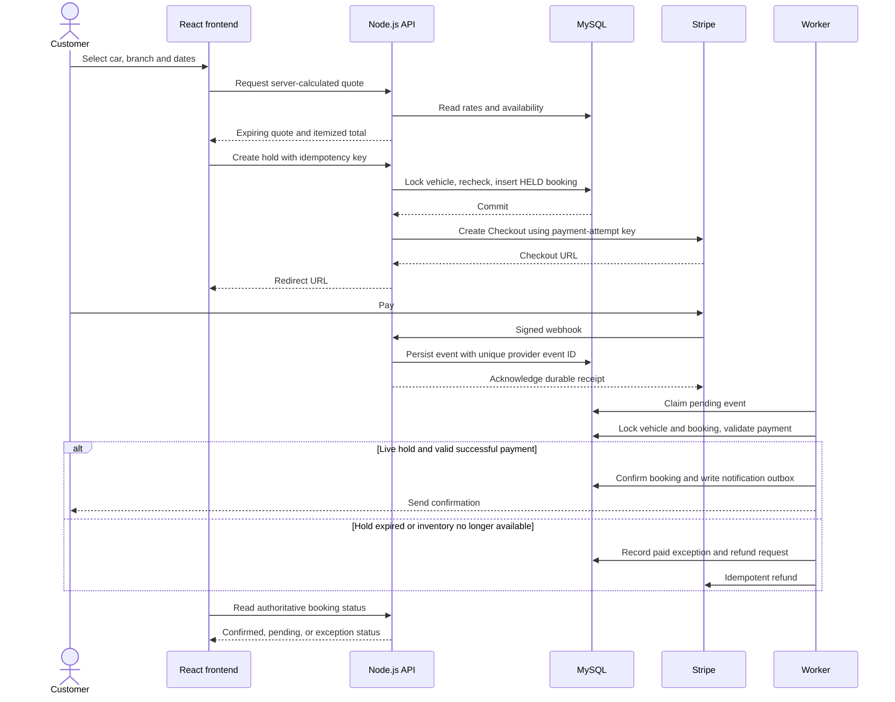
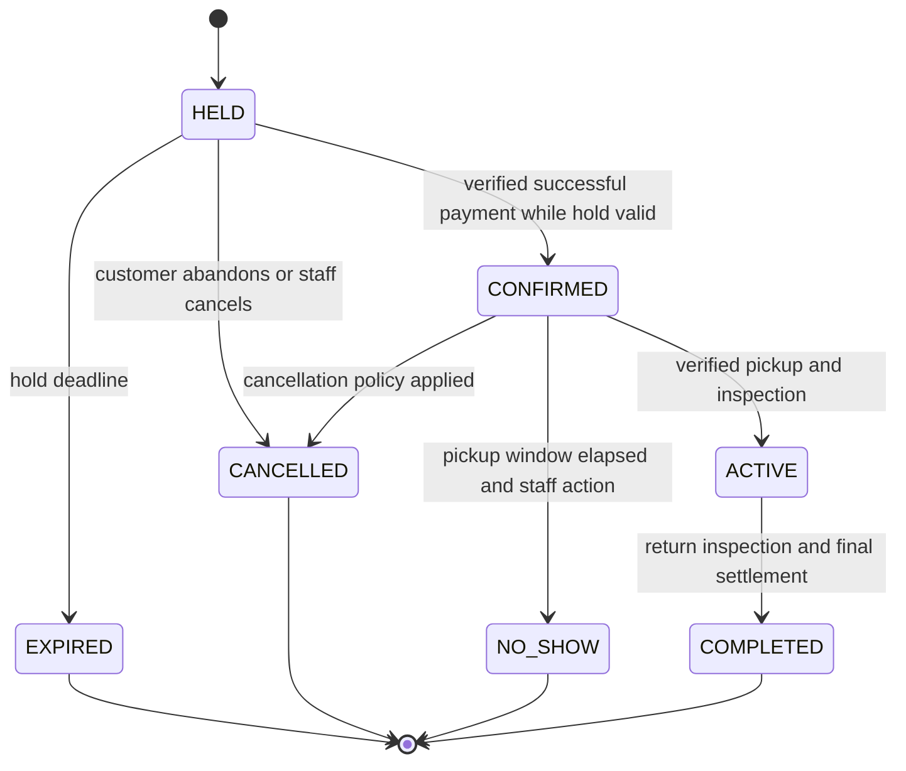
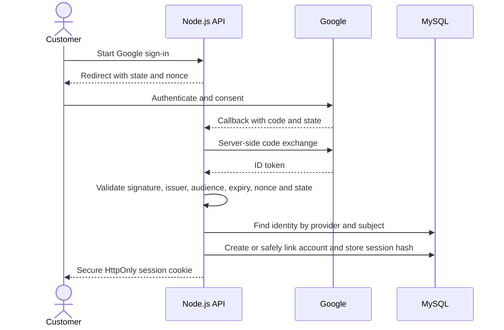

# Proposed MySQL data model and application flows

Status: implementation specification, not deployed tables. The shared Docker server creates an empty `lerviz` database. Prisma migrations will create the application tables during the Node.js migration.

## Core ERD

One vehicle record represents one physical rentable car. A booking reserves that physical car. A quote does not reserve inventory. A booking hold does.

Cardinality notes: quote conversion and review creation are optional and at most one per booking/quote. Refund and payment records are append-oriented attempts, not a single mutable `is_paid` flag. Nullable provider IDs allow recording the attempt before a remote request. Driver verification is needed before handover; collecting documents before checkout is a configurable business policy.

## Supporting tables and constraints

| Table | Key fields / rules |
| --- | --- |
| `webhook_events` | Provider + provider event ID unique; received/processed timestamps, status, retry count, minimal payload with retention policy |
| `outbox_events` | ID, aggregate ID, event type, payload, available_at, published_at, attempts; written in the same transaction as booking/payment updates |
| `idempotency_requests` | User ID + route + key unique, request hash, result reference, expiry; same key with different request returns conflict |
| `auth_tokens` | User FK, hashed token, purpose, expiry, used_at; one-time email verification/password reset |
| `audit_logs` | Actor, action, entity ID/type, redacted changes, request ID, timestamp; restricted access |
| `notifications` | User/booking optional FKs, channel, template, delivery status, provider message ID; deduplicate on event and recipient |
| `contact_requests` | Optional user FK, name, email, message, consent, status, assigned staff, created_at |
| `blog_posts` | Author FK, unique slug, title, sanitized content, publication state, timestamps |
| `favorites` | User ID + vehicle ID composite unique key; optional post-MVP |
| `inspection_media` | Inspection FK and private object storage key; no public document URLs |

Use InnoDB, `utf8mb4`, UTC `DATETIME(3)` timestamps, branch IANA timezone for display and local-day rules, and opaque UUID IDs. Use normalized/canonical email with a unique index and case-sensitive provider identifiers. Store monetary values in integer currency minor units, serialize large integers safely, and never use binary floating point for money. Establish maximum supported amounts. Tax percentages can use decimal values with explicit rounding per policy.

Indexes: booking `(vehicle_id, status, pickup_at, occupied_until)`, booking `(user_id, created_at)`, holds `(status, hold_expires_at)`, block `(vehicle_id, starts_at, ends_at)`, vehicle `(branch_id, category_id, status)`, events `(status, received_at)`. Inspect real query plans before adding more indexes. These indexes accelerate searches; they **do not enforce non-overlap**.

Checks: return > pickup, occupied_until >= return, amount >= 0 except explicitly signed discount items, rating 1–5, fuel 0–100, valid state values, refund totals no greater than captured amount. Enforce policy and cross-table invariants in a transaction. Keep booking/payment history; archive vehicles and users according to retention requirements instead of cascading away financial records.

## Preventing double bookings

Proposed invariant: all writers of vehicle occupancy (new holds, extensions, reassignment, cancellation, maintenance blocks and payment confirmation) acquire the **same physical vehicle row lock** before changing occupancy.

1. Start a short MySQL transaction. Lock the requested vehicle with parameterized `SELECT id FROM vehicles WHERE id = ? FOR UPDATE`.
2. Use locking/current reads for conflicting bookings and vehicle blocks. Do not rely on a stale consistent-read snapshot. Exclude expired holds by database time even if the expiry worker is delayed.
3. An overlap exists when `existing.pickup_at < requested.occupied_until AND existing.occupied_until > requested.pickup_at`. Intervals are half-open. Include cleaning/turnaround time.
4. Revalidate branch, operational status, dates, quote expiry, currency, rate/promotion eligibility and driver requirements; atomically reserve promotion capacity if capped.
5. Insert a `HELD` booking, immutable price items, an expiry timestamp (proposed 15 minutes) and an outbox event. Commit.
6. Contact Stripe **after committing**, using a stable payment-attempt idempotency key. Never hold a database lock during a network call.
7. If checkout creation fails, retry the same attempt safely or release the hold through the same lock discipline. A worker recovers interrupted attempts.

Lock multiple vehicles in sorted ID order for reassignment and apply bounded retry for deadlocks. Every staff tool must follow the same occupancy service. A Redis lock alone is insufficient as the booking correctness mechanism. MySQL supports transactional locking reads; the protocol above is this project's design choice. [MySQL locking-read documentation](https://dev.mysql.com/doc/refman/8.4/en/innodb-locking-reads.html).

## Booking and payment flow

The success redirect alone never confirms payment. Validate event signature against the raw body, expected amount/currency, booking metadata, provider account and mode. Deduplicate events and tolerate out-of-order delivery. A success event after local hold expiry must not silently displace a later booking. Default policy is refund and notify; manual exception resolution is audited. Only enable immediate payment methods initially; delayed methods need a longer reservation policy. Stripe specifies signature verification and duplicate/out-of-order event handling in its [webhook guide](https://docs.stripe.com/webhooks), and request deduplication in its [idempotency guide](https://docs.stripe.com/api/idempotent_requests).

Payment states are separate: `CREATED`, `PENDING`, `AUTHORIZED`, `SUCCEEDED`, `FAILED`, `PARTIALLY_REFUNDED`, `REFUNDED`. Refund attempts have their own pending/succeeded/failed state. Rental charges and security deposits are separate purposes; do not assume a card authorization can stay open until a distant pickup date. Finalize the deposit provider workflow before release.

## Google sign-in flow

Use Google's provider subject as identity, never an unverified browser email. Existing accounts require explicit authenticated linking rather than automatic merging by email alone. Do not request Google Drive or other unnecessary scopes. Client secret stays on the backend. This flow follows [Google's OpenID Connect server-flow guidance](https://developers.google.com/identity/openid-connect/openid-connect).
