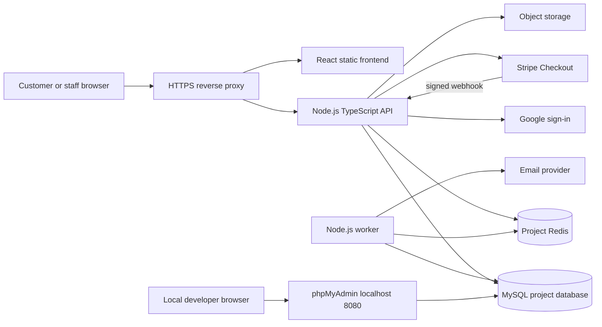
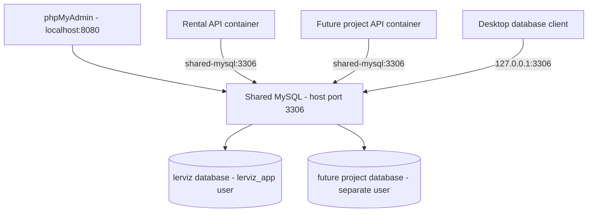

# Lerviz — project audit and completion specification

**Review date:** 13 October 2026  
**Basis:** working-tree source review, configuration inspection, limited local build checks, and official architecture/integration documentation.  
**Scope:** existing functionality, gaps, proposed Node.js/MySQL backend, Docker operation, frontend design, ERD, third-party configuration, and delivery criteria.

## 1. Executive assessment

The repository is a visually developed **automotive showroom prototype**, not yet an operational rental platform. It has a React landing page with animation and supporting page shells. Its Python backend demonstrates database/Redis connectivity but contains no rental domain models, bookings, authentication, payments, or administration.

The completion direction is a **rental-first application** using React, a TypeScript Node.js API, MySQL, Redis background jobs, and Docker. Preserve and refine the useful visual work, then implement a complete customer booking journey and staff operations. Adopt a modular monolith rather than independently deployed business microservices at this stage.

Your additional requirement is incorporated: run **one shared MySQL development server** for this and future projects, with **phpMyAdmin** for browser administration. All schemas share the same MySQL port. Each project gets separate database credentials. The shared database stack has an independent lifecycle from application stacks.

### Deliverables and implementation boundary

| Deliverable | Status in this task |
| --- | --- |
| Repository audit and completion specification | This report |
| Proposed database ERD and booking/payment/authentication flows | [DATABASE_AND_FLOWS.md](DATABASE_AND_FLOWS.md) |
| Shared MySQL + phpMyAdmin Docker configuration | [infra/shared/compose.yml](../infra/shared/compose.yml) |
| Local setup and future-project connection instructions | [infra/shared/README.md](../infra/shared/README.md) |
| Blank third-party integration configuration | [integrations.env.example](integrations.env.example) |
| Node.js API, business tables, complete rental UI and provider integrations | Proposed implementation; not yet built |

The original request foregrounded a report. This deliverable therefore specifies the full rebuild and implements the subsequently requested shared database infrastructure. It does not represent the backend migration or frontend redesign as complete. Existing uncommitted frontend image changes and `replace.py` were preserved.

## 2. Current repository specifications

One Git repository contains two application directories; there are no separate application repositories in the inspected tree.

| Area | Current implementation | Evidence |
| --- | --- | --- |
| Frontend | React 18, JavaScript/JSX, Vite, React Router 6, Tailwind 4 | `Frontend/package.json`, `src/main.jsx`, `vite.config.js` |
| Motion | Framer Motion, CSS ticker, IntersectionObserver counters; GSAP packages declared but no source use found | Components, `src/index.css` |
| API | FastAPI, Python 3.11 Docker image, SQLAlchemy, Pydantic settings | `Backend/app/*`, `Backend/Dockerfile.dev` |
| Database | PostgreSQL 16 in existing Compose; engine/session scaffolding only | `Backend/app/database.py`, root Compose |
| Cache | Redis 7 container; ping and demo increment | `Backend/app/redis_client.py`, `main.py` |
| Development infrastructure | Four services: postgres, redis, backend, frontend | `docker-compose.yml` |
| Delivery automation | GitHub Actions installs dependencies/builds frontend, then attempts image build and SSH deployment | `.github/workflows/ci-cd.yml` |
| Documentation | Generic Vite README and environment example | `Frontend/README.md`, `.env.example` |

### Pages and visible functionality

| Feature | Present behavior | Missing for completion |
| --- | --- | --- |
| `/` home | Video hero, logo ticker, counters, about section, three vehicle showcases, benefits, testimonials, offers, second video, team, gallery, blog teasers, CTA | Rental-oriented search, real data, correct offers and working journeys |
| `/about` | Heading and short template paragraph | Real company information, branches, policies and team |
| `/contact` | Animated image/title hero | Contact form, contact details, validation, submission API and delivery |
| Navigation | Animated overlay, route-change close, scroll lock, desktop contact link | Keyboard focus management, Escape handling, usable links to real pages |
| Vehicle showcase | Three hardcoded cars; name, speed, transmission, year; parallax cards | Search, pricing, availability, database data, detail pages, booking |
| Testimonials | Three local entries selectable by avatar | Verified reviews, moderation and real approved content |
| Gallery | Sticky 300vh section converts scroll progress to horizontal movement | Responsive travel calculation, reduced-motion/mobile alternative |
| Blog and team | Static teaser and profile data | Article routes and editorial workflow |
| Promotions | Static sale and financing copy | Actual rental promotions, eligibility and expiry enforcement |
| Backend `/` | Service metadata | No rental behavior |
| Backend `/health` | Runs SQL `SELECT 1` and Redis ping; 503 on dependency failure | Separate liveness/readiness, sanitized errors |
| Backend `/api/demo-counter` | Increments Redis `page_hits` | Demo only; not booking analytics |

Only `/`, `/about`, and `/contact` are registered in `Frontend/src/App.jsx`. Links to `/inventory`, `/inventory/:slug`, `/services`, `/blogs`, `/404`, and legal pages lack matching routes. `pages/Inventory.jsx` exists but is a placeholder and is not registered. No frontend API calls, form submission handlers, database model definitions, business migrations, or test files were found in the inspected application source.

### Existing design strengths

The prototype already has a consistent dark automotive style, local imagery, a video identity, animated text, card reveals, image parallax, and a shared header/footer. These are usable foundations. The required improvement is to make that visual style support rental decisions: dates, location, total cost, vehicle suitability, and a clear booking action.

## 3. Findings and priorities

| Priority | Finding and evidence | Required action |
| --- | --- | --- |
| P0 | No booking, identity, payments or fleet data model | Build and test the rental domain before launch |
| P0 | Prominent navigation and vehicle links have no routes (`App.jsx`, navbar/footer/cards) | Implement routes and a catch-all 404; audit every internal link |
| P0 | CI references missing `Backend/Dockerfile`, `Frontend/Dockerfile`, and `docker-compose.prod.yml` | Create production assets and make build/deploy validation explicit |
| P1 | Product copy sells cars, test drives, financing and warranties despite rental project name | Establish rental positioning; replace purchase-only claims and calls to action |
| P1 | Current credentialed CORS uses wildcard origins (`Backend/app/main.py`) | Use explicit allowed origins or same-origin reverse proxy |
| P1 | All current containers receive the root `.env`; database/cache host ports are published | Scope environment by service; expose only necessary local endpoints |
| P1 | Health response returns raw dependency exception text | Log internal details server-side and return safe service status |
| P1 | Existing volumes depend on `D:/docker-data/...`; service startup is not health-gated | Use portable named volumes and readiness-aware startup |
| P1 | Inventory images have fixed 726px width and 497.33px height inside narrow cards | Use responsive sizing and verify 320–1440px widths |
| P1 | No reduced-motion branch found; two autoplay videos and continuous/scroll animation | Add motion preferences, pause controls and static alternatives |
| P1 | Fullscreen navigation lacks complete dialog/focus behavior | Focus trap, restore focus, Escape close, inert background and keyboard tests |
| P1 | Automated checks do not run business tests; no lint/test scripts declared | Add TypeScript, lint, domain/integration and end-to-end checks |
| P2 | `Navbar` calculates `hidden` and `scrolled` without applying them to the rendered header | Implement intended behavior or remove unused state |
| P2 | Repeated AnimatedHeading, rolling-button and blur-layer implementations | Consolidate reusable design primitives |
| P2 | `eslint.config.js` imports packages absent from `package.json` | Install/configure supported lint dependencies and add a script |
| P2 | Several images remain on Framer-hosted URLs; largest local JPEG is about 9.06 MB | Confirm asset rights, optimize and serve controlled responsive assets |
| P2 | Basic HTML title only; no route-specific metadata or sitemap found | Add meaningful page titles, descriptions, canonical URLs and sitemap |
| P2 | Footer watermark adds another H1; decorative brand dominates heading hierarchy | Make a meaningful primary page H1; mark decorative duplication appropriately |
| P2 | Repository says Lerviz while UI says Levrix | Select one brand spelling before launch |

The workflow comment promises a zero-downtime rolling restart, but `docker compose up -d` alone does not establish that behavior. Define either a tested maintenance-window deployment or a real proxy-backed blue/green rollout.

Displayed sales totals, customer satisfaction, testimonials, partner logos and inspection claims are hardcoded content, not verified business facts. Publish only content approved by the business owner.

### Checks performed and limits

- Source/configuration review covered the frontend pages and components, backend modules, Dockerfiles, Compose, environment example and CI workflow. Secret values from the existing root `.env` were not printed or used in the report.
- `npm run build` failed because `vite` was not available in the existing local dependency installation. This is an environment/dependency failure, not proof of a source compilation error. A clean lockfile install and build remain required.
- Existing Compose syntax validation completed, but the legacy Python stack was not launched. Its pinned Python dependencies were not installed or verified during this review.
- Docker client/server access was verified outside the sandbox. Shared-stack validation and runtime results are recorded in [VALIDATION.md](VALIDATION.md).
- No browser visual inspection, Lighthouse run, accessibility certification, provider end-to-end transaction or application load test is claimed. Frontend layout concerns above are source-based findings to verify in the browser.

## 4. Target product specification

**Working assumptions:** one rental business with multiple branches; one physical car per booking; one configured currency at initial launch; self-drive rental; customer accounts required for checkout; browsing and quoting public. These are proposed defaults, not discovered business rules. Business jurisdiction, taxes, age limits, license rules, cancellation terms and deposit policy still need owner decisions.

### Roles

| Role | Capabilities |
| --- | --- |
| Visitor | Browse available fleet, filter, view details, get quotes, read policies, contact support |
| Customer | Email/password or Google login, own profile, booking, payment, cancellation, receipts and eligible review |
| Rental staff | Branch-scoped booking management, customer verification, pickup/return, inspections and maintenance blocks |
| Administrator | Fleet, branches, pricing, promotions, staff permissions, content, refund authorization and reports |

Authorize operations in the API by role, record ownership and branch scope. Hiding a frontend button is not authorization. High-privilege staff accounts need MFA and audit trails before production.

### Required customer functionality

| Module | Specification / acceptance |
| --- | --- |
| Search | Pickup/return branch, dates and times; category, seats, transmission, fuel, price filters; stable sort and pagination; URL preserves filters |
| Availability | Excludes overlapping active holds/bookings and maintenance; rechecked when booking, not only on search |
| Vehicle detail | Responsive gallery, luggage/seats, transmission, fuel, mileage allowance, requirements, terms, pickup point and price summary |
| Quote | Server-calculated itemization of rental days, extras, discount, tax, fees and deposit; explicit expiry and policy version |
| Checkout | Driver/account details, selectable extras, policy consent, temporary inventory hold, payment and recoverable error states |
| Confirmation | Unique booking reference, dates, branch, paid/owed amounts, next steps and receipt; authoritative API payment state |
| Customer account | Current/past bookings, cancellation eligibility, refund progress, profile, session logout and password recovery |
| Communication | Booking confirmation, pickup reminders, cancellation/refund messages and operational exception alerts |
| Support | Validated contact form, submission acknowledgement, staff assignment and spam controls |
| Reviews | Only one moderated review per completed booking; no unverified “verified” badges |

Define minimum rental duration, local-day versus elapsed-24-hour charging, cleaning buffer, late return, no-show, one-way return and holiday rules before pricing implementation. Initially require same-branch return unless relocation operations are designed. Do not infer tax rules from the project's location or the requested developer persona.

### Required staff functionality

- Fleet CRUD with images, unique VIN/registration, branch, operational status and archived vehicles.
- Calendar of holds, bookings, returns and maintenance; availability changes use the same transaction rules as public booking.
- Pricing rules with deterministic priority, discount caps, seasonal dates and quote snapshots.
- Booking search, status history, reassignment, extension and cancellation with conflict rechecks.
- Pickup/return workflow with license verification, inspection photos, fuel, odometer and signed acknowledgement.
- Payment/refund reconciliation, failed-event queue and retry actions; never edit a paid total without an adjustment record.
- Operational reporting for utilization, upcoming pickups, overdue returns, gross charges, refunds and net revenue with timezone/currency definitions.
- Content and policy editing, staff access management and auditable administrative actions.

Post-MVP additions: wishlists, vehicle comparison, loyalty credits, corporate accounts, SMS/WhatsApp, multilingual content, chauffeur delivery and advanced revenue management. These should not delay reliable booking, fleet operations and payments.

## 5. Proposed Node.js backend architecture

### Technology decisions

| Concern | Proposed choice and reason |
| --- | --- |
| Runtime | Node.js 24 LTS baseline; pin tested patch/image digest for releases |
| Language | TypeScript with strict checking across API/domain code |
| API framework | NestJS modular monolith, using its standard HTTP adapter; modules map to business capabilities |
| Database | MySQL 8.4 / InnoDB; shared local server, separate schema/user per project |
| Data access | Prisma schema, reviewed migrations and typed data access; narrowly scoped parameterized SQL for locking where needed |
| Cache and jobs | Project-scoped Redis plus BullMQ workers; database remains source of truth |
| Authentication | Server-side sessions with hashed opaque tokens; HttpOnly cookies; email/password and Google OpenID Connect |
| Payments | Stripe-hosted Checkout initially; webhook-driven updates, refunds and reconciliation |
| Validation | DTO input validation, allowlisted fields, clear response schemas, generated OpenAPI |
| Logging | Structured JSON logs with request IDs and redaction; health endpoints and metrics |
| Testing | Unit tests for domain rules; real-MySQL integration tests; browser end-to-end flows |

The runtime baseline is supported by the [Node.js release information](https://nodejs.org/en/about/previous-releases). NestJS documents its [module structure](https://docs.nestjs.com/modules); Prisma documents [MySQL support](https://www.prisma.io/docs/orm/overview/databases/mysql). Exact compatible package versions must be locked and tested during implementation rather than copied blindly from this report.



### Module and code structure

```text
Backend/
  src/
    main.ts
    app.module.ts
    config/                  # validated runtime settings
    common/                  # errors, logging, guards, request context
    infrastructure/          # database, queue, mail, payments, storage adapters
    modules/
      auth/ users/ branches/ fleet/ availability/
      pricing/ bookings/ payments/ inspections/
      notifications/ content/ reporting/ audit/
  prisma/
    schema.prisma
    migrations/
    seed.ts                  # development-only representative data
  test/                      # integration and concurrency coverage
  Dockerfile                 # production stages, non-root runtime
  Dockerfile.dev
  package.json
  package-lock.json
```

Controllers parse HTTP input and invoke use cases. Services enforce business rules and own transactions. Repositories contain queries. Provider adapters implement interfaces so tests/local development do not require external keys. Dependencies flow toward domain logic; pricing code should not know about Express, Stripe SDK types or UI components.

Centralize errors such as `VEHICLE_UNAVAILABLE`, `QUOTE_EXPIRED`, `PAYMENT_PENDING`, and `INTEGRATION_NOT_CONFIGURED`. Use consistent status codes, request IDs, bounded pagination, validation and safe messages. Keep domain status transitions explicit. Do not scatter pricing or payment confirmation across controllers.

Use a transactional outbox for booking notifications and provider processing: database changes and the intent to enqueue work commit together, then a dispatcher delivers jobs. Consumers must be idempotent because retries can occur. Add graceful shutdown, bounded database pools, startup retries and separate `/health/live` and `/health/ready` endpoints.

### Proposed API surface

All business endpoints use `/api/v1`. The table is an implementation contract outline, not existing routes.

| Area | Representative endpoints | Authorization |
| --- | --- | --- |
| Auth | `POST /auth/register`, `/login`, `/logout`, `/forgot-password`, `/reset-password`; `GET /auth/google`, `/auth/google/callback` | Public start, protected mutations where relevant |
| Profile | `GET/PATCH /me`, `GET /me/bookings` | Customer's own records |
| Catalog | `GET /branches`, `/vehicles`, `/vehicles/:slug`, `/vehicles/:id/availability` | Public |
| Pricing | `POST /quotes` | Public, rate-limited |
| Reservations | `POST /bookings`, `GET /bookings/:id`, `POST /bookings/:id/cancel` | Owner; idempotency on creation/cancellation |
| Payment | `POST /bookings/:id/checkout`, `GET /bookings/:id/payments` | Owner |
| Webhook | `POST /webhooks/stripe` | Verified provider signature, raw request body |
| Contact/review | `POST /contact`, `POST /bookings/:id/review` | Public contact; eligible booking owner for review |
| Admin fleet | `POST/PATCH /admin/vehicles`, `/admin/branches`, `/admin/rates`, `/admin/blocks` | Authorized administrator/staff scope |
| Operations | `/admin/bookings/:id/pickup`, `/return`, `/extend`, `/reassign`, `/refunds` | Staff permissions and branch/amount constraints |
| Reporting | `GET /admin/reports/utilization`, `/revenue`, `/audit` | Role-scoped |

Use 400 for malformed requests, 401/403 for authentication/permission, 404 for inaccessible/missing resources, 409 for conflicts/expired holds, 422 for supported validation semantics if consistently adopted, 429 for throttling and 503 for unavailable required services. Client retries use an idempotency key and cannot trust a submitted price or user ID.

## 6. MySQL, ERD and shared Docker operation

The [database design](DATABASE_AND_FLOWS.md) contains the complete core ERD, supporting table inventory, field constraints, indexes, booking state machine, and sequence diagrams. It distinguishes quote, hold, booking, charge, security deposit and refund.

### Shared development topology



MySQL and phpMyAdmin use different protocols, so they have separate ports. **Adding databases does not add MySQL ports.** Containers from different projects join the `shared-dev-data` Docker network. The shared stack creates `shared-dev-mysql-data` as a persistent named volume. New projects receive schema-scoped privileges and never the root application credential.

The setup binds MySQL and phpMyAdmin to localhost. phpMyAdmin has no automatic root login; credentials must be entered. Its official image supports `PMA_HOST`/`PMA_PORT`, as documented in the [phpMyAdmin image reference](https://hub.docker.com/_/phpmyadmin). Cross-project connectivity uses an externally referenced network in each application Compose file, following [Docker's networking model](https://docs.docker.com/compose/how-tos/networking/).

### Full application container plan

| Stack | Containers | Lifecycle |
| --- | --- | --- |
| Shared local infrastructure — supplied now | MySQL, phpMyAdmin | Start once; independent from any project |
| Rental development — to build | React/Vite, Node API, Node worker, Redis, local mail inbox | Start/stop per project; hot reload and named dependency volumes |
| Rental production — to build | Reverse proxy/static frontend, API, worker, Redis; private MySQL or managed database | Immutable images, secrets, migration job, health gates |

Production images should use multi-stage builds, `npm ci`, non-root users, no development bind mounts and no broad shared `.env` injection. Build the SPA with only public environment values; proxy `/api` to the API and configure SPA fallback for direct page loads. A separate migration job runs before new app instances become ready. Pin release images by digest and deploy the same artifact tested in staging.

Use a single replica/maintenance-window deployment first if acceptable; promise zero downtime only after implementing and testing blue/green switching and backward-compatible migrations. Never publish phpMyAdmin publicly as part of the customer website. Set and test database backup recovery targets, encryption, retention and restoration before launch.

The current root Compose remains the Python/PostgreSQL setup. It cannot become a MySQL backend merely by replacing the database image; the API code, ORM, settings, migrations, CI and application Compose must be migrated together. Preserve any existing PostgreSQL data and determine whether live business records exist before planning export/import. No such data was inspected during this audit.

## 7. Frontend design and animation specification

### Visual direction

Keep the premium automotive identity, but use more readable typography and clearer transaction surfaces. Suggested system: charcoal `#0B0D10`, raised panels `#151A20`, warm white `#F6F7F9`, muted text `#A9B1BD`, and a restrained red action accent. Verify actual text/background contrast rather than assuming a palette passes accessibility.

Use the display face sparingly for major headings; use Manrope or a similar readable face for body copy, forms and prices. Establish 4/8px spacing increments, consistent card radii, controlled shadows, responsive gutters and a 1200–1440px content limit. Use authentic vehicle photography with consistent crops and no fictitious availability, ratings or promotional claims.

### Page composition

| Page | Proposed layout |
| --- | --- |
| Home | Short cinematic hero with rental headline and primary date/location search; featured fleet; how rental works; benefits; verified reviews; branches; FAQ; final CTA |
| Fleet results | Search summary, filter sidebar/drawer, sort/count, responsive cards with daily and trip totals, empty state and pagination |
| Vehicle detail | Responsive gallery, key specs, inclusions/exclusions, requirements, reviews and desktop sticky booking panel |
| Checkout | Three clear steps: trip/extras, driver/account, payment; persistent itemized summary; inline validation and hold-expiry feedback |
| Account | Upcoming trip cards, booking detail timeline, receipts, cancellation/refund status and profile |
| Contact | Actual branch details, accessible form, optional map and support hours |
| Staff area | Dense but readable tables, fleet calendar, filters, clear statuses and confirmation for consequential actions |

Vehicle cards prioritize seats, luggage, transmission, mileage allowance and price; top speed is secondary for a rental decision. A mobile sticky action must leave enough viewport space and must not hide inputs or focus targets.

### Motion behavior

| Interaction | Intended behavior | Accessibility/performance fallback |
| --- | --- | --- |
| Hero | Brief opacity/translate introduction; modest background drift | Static poster and immediate readable copy with reduced motion |
| Section entrance | One-time 16–24px rise, 300–500ms, short stagger | No hidden content or spatial movement when motion disabled |
| Vehicle showcase | Small transform-only parallax on desktop | Static grid on touch/reduced-motion layouts |
| Editorial gallery | Optional bounded sticky/horizontal sequence with measured track width | Standard vertical grid or native swipe list; no forced 300vh mobile journey |
| Hover/press | 150–220ms color, border and subtle scale | Equivalent keyboard focus and pressed states |
| Route change | Minimal fade; restore appropriate scroll and move focus to page heading | Immediate navigation without delay |
| Checkout | Short step transition and visible progress | No decorative scroll animation in critical form completion |

Keep Framer Motion as the primary React motion tool. Introduce GSAP ScrollTrigger only if a measured, specific editorial sequence needs it; otherwise remove unused GSAP packages. Avoid multiple engines controlling the same element. Respect `prefers-reduced-motion`, stop offscreen video playback, provide a pause control for continuous motion and retain native scrolling. These are project design requirements; test against relevant [WCAG motion guidance](https://www.w3.org/WAI/WCAG22/Understanding/animation-from-interactions.html).

### Quality targets

- Complete keyboard navigation, visible focus, correctly associated form labels/errors, focus restoration for overlays, meaningful alt text and a skip link.
- Verify 320, 375, 768, 1024 and 1440px viewports, 200% zoom, reduced motion and touch behavior.
- Resize the 9MB inventory JPEG and other large images into responsive AVIF/WebP sources. Reserve image dimensions, lazy-load below-the-fold media and avoid eager loading a second full-screen video.
- Proposed performance goals: mobile LCP ≤2.5s, INP ≤200ms and CLS ≤0.1 at the 75th percentile once real traffic exists. Before launch, run representative lab tests; these are targets, not measured results.
- Add route-level loading, empty/error/retry states, accessible success messages, expired-quote recovery and a real 404 page.
- Use route-specific metadata and crawlable public content. Evaluate prerendering public marketing/detail pages if organic search is an acquisition requirement; do not change frontend frameworks solely for visual polish.

## 8. Third-party services and your keys

All provider credentials in [integrations.env.example](integrations.env.example) are **intentionally blank**. You will enter your own account credentials into the future application's ignored local environment or production secret manager. That template is documentation for the proposed Node.js application; the current Python application does not implement these integrations.

| Service | Purpose | Your configuration | Behavior before configured |
| --- | --- | --- | --- |
| Google OpenID Connect | Optional social login | `GOOGLE_CLIENT_ID`, `GOOGLE_CLIENT_SECRET`, exact `GOOGLE_REDIRECT_URI` | Google action disabled/hidden; email login remains available |
| Stripe | Rental checkout, refunds, payment events | `STRIPE_SECRET_KEY`, `STRIPE_WEBHOOK_SECRET`; optional public key for Elements | No live card checkout; explicit unavailable state |
| SMTP or Resend — choose one production provider | Verification, reset and booking email | SMTP credentials or `RESEND_API_KEY`, verified sender/domain | Local mail inbox in development |
| Google Maps — optional | Branch map/autocomplete | `VITE_GOOGLE_MAPS_API_KEY` with domain/API restrictions | Plain address and branch selector |
| S3-compatible storage | Vehicle images and private driver/inspection files | Endpoint, region, bucket, access ID and secret | Development local storage adapter |
| Twilio — later phase | SMS confirmations/reminders | Account SID, auth token, sender number | SMS disabled; email remains primary |
| Sentry — optional | Error reporting | `SENTRY_DSN` and environment | Structured local/server logs |

Configuration rules:

1. Never put Google client secrets, Stripe secret keys, database passwords, storage secrets or SMS tokens in `VITE_*` variables or frontend bundles. Public browser keys are restricted by allowed origins/APIs; they are not secret credentials.
2. Validate required local settings at startup. If an optional provider flag is off, do not instantiate it with a fake key. If the flag is on and required values are blank, produce a clear configuration failure. Production should fail readiness if a required payment/mail integration is missing.
3. Register Google's callback URLs for each environment and configure its consent screen. The API validates `state`, nonce and ID-token claims. No automatic account linking by untrusted email. See the [Google server-flow documentation](https://developers.google.com/identity/openid-connect/openid-connect).
4. Use Stripe test mode during development and configure the signed webhook endpoint `/api/v1/webhooks/stripe`. A webhook signing secret is distinct from an API key. Signature checks use the unmodified raw body. Provider setup also requires an eligible account, event configuration and testing; pasting keys alone is insufficient. See [Stripe's webhook guide](https://docs.stripe.com/webhooks).
5. Restrict object uploads by size/type, verify content, scan sensitive files where appropriate, and use short-lived signed links for private documents. Sanitize provider errors and redact personal data/secrets in logs.
6. Keep local simulation adapters clearly labeled and impossible to select accidentally in production. Never mark a booking paid just because Stripe is disabled.

## 9. Security, reliability and test acceptance

Use modern password hashing such as Argon2id, session rotation at login, revocation at logout/password change, HTTPS, HttpOnly/Secure cookies in production, CSRF protection for cookie-authenticated mutations, explicit CORS, request size limits, rate limiting and least-privilege authorization. Store reset/verification tokens as hashes with expiry and single-use semantics. Do not store raw card details.

| Test group | Required acceptance evidence |
| --- | --- |
| Pricing | Duration/rounding boundaries, branch timezone/DST, promotion caps, extras, policy snapshots and currency handling |
| Concurrency | Two simultaneous overlapping holds produce one success; maintenance and booking race safely; extensions cannot overlap |
| Payments | Duplicate/out-of-order webhooks, invalid signature, mismatched total/currency, retry after timeout, expired hold with late success, refund retry |
| Authorization | Customer cannot fetch/change another booking; staff cannot cross unauthorized branches; normal user cannot grant roles |
| Authentication | Reset/verification token replay rejected; session revoked; Google callback state/nonce failure handled |
| Fleet operations | Pickup/return transition validation, maintenance, no-show, inspection evidence and auditable reassignment |
| UI | Date selection → quote → sign-in → hold → test payment → confirmation; mobile and keyboard equivalents |
| Infrastructure | Fresh Docker start, readiness, restart persistence, migration from prior version, backup restore and project-user isolation |
| Integration outages | Redis/mail/provider failure does not lose committed booking/payment records; retries and operator recovery work |

CI should run locked dependency installation, lint/type checks, unit/integration tests on an isolated MySQL test schema, frontend build and Docker image build. Do not run destructive tests against shared development databases. Add end-to-end smoke tests and migration verification before deployment. Scan dependencies/images and protect release secrets.

Proposed starting operational objectives: 99.9% monthly availability, off-host daily backups plus binary-log recovery where supported, RPO ≤1 hour and RTO ≤4 hours. These are planning targets requiring infrastructure sizing, cost agreement and actual restore tests; they are not current guarantees.

## 10. Delivery roadmap

| Phase | Work | Completion gate |
| --- | --- | --- |
| 0 — product decisions | Brand, rental rules, branches, currency, payment/deposit policy, approved copy and assets | Owner-approved requirements and representative journeys |
| 1 — foundation | Shared DB, Node/TypeScript modules, schema/migrations, settings, app Docker, CI and seed data | New developer can start the full stack and run isolated tests |
| 2 — catalog and design system | Routes, accessible components, search, detail pages, branch data, responsive media | Fleet search reads real API data; all public links resolve |
| 3 — identity and bookings | Email/Google auth, quotes, holds, account pages, concurrency controls | Real-MySQL overlap and ownership tests pass |
| 4 — payments and operations | Stripe sandbox, webhook inbox/outbox, refunds, staff fleet/pickup/return, email | Complete booking-to-return scenario and recovery scenarios pass |
| 5 — polish and release | Scroll motion, mobile/accessibility/performance checks, production Docker, migrations, monitoring and restore drills | Staging acceptance and tested deployment/rollback |

A rough planning range is **10–16 weeks for one experienced full-time developer with timely design, product and QA support**; this is a scope-based estimate, not a commitment. Broad admin features, document verification, complex tax/deposit rules or custom editorial animation can extend it. Parallel staffing changes the estimate and requires a separate plan.

### Decisions still needed before business implementation

- Final brand spelling and whether sales/test drives remain as separate services.
- Operating country/region, currency, branches, hours and authoritative tax/cancellation/driver policies.
- Same-branch versus one-way rentals; specific vehicle versus category reservation.
- Security deposit amount, authorization/collection timing, refunds, late return and damage settlement.
- Allowed payment methods, guest checkout versus required account, and document-verification process.
- Production hosting, expected traffic/fleet size, recovery objectives, service budget and asset/content approvals.

These decisions do not block the supplied local MySQL/phpMyAdmin setup. They do govern the final pricing engine, schema details, checkout wording and operational acceptance tests.
